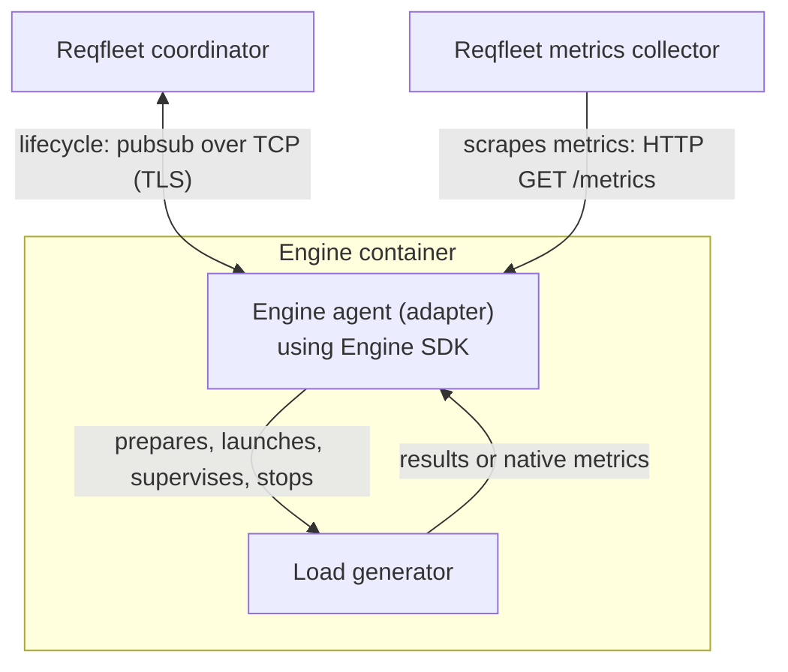

# Engine SDK

Engine SDK is the public Go runtime for load-testing engines on **Reqfleet**.
An engine agent (adapter) uses it to manage a load generator, coordinator
communication, and metrics collection.

The SDK exposes the callback contract used by JMeter, Locust, and Replay.
It was extracted from Reqfleet's Shibuya control plane.
It uses public dependencies and supports adding new engines to Reqfleet.

## Why this exists

Each engine must consume its assigned workload and files, prepare dependencies,
and report readiness and results. It must stop and clean up before the next run.

The SDK handles coordinator communication and process supervision.
Adapters translate assigned settings, build commands, and map engine output to
Reqfleet's reporting contract. Each engine retains its execution model.

## Basic architecture



The coordinator assigns workload settings and per-file inputs to each agent.
The adapter translates those assignments unchanged.
The runtime owns the primary process and serializes runs.
Cleanup finishes before the next run reuses the workspace.

Agents require a coordinator. The control plane owns engine registration,
deployment, storage, and reporting. Coordinate engine registration separately
when adding an adapter.

## Using the SDK

Check the [latest release notes](https://github.com/reqfleet/engine-sdk/releases/latest)
for the current version and changes. Add the SDK to an adapter's Go module:

```sh
go get github.com/reqfleet/engine-sdk@latest
```

Pin the SDK version and review compatibility when upgrading. The Go API is pre-1.0.
Read documentation at the matching source tag. The default branch may contain
unreleased changes. Use the Go toolchain required by that release's [go.mod](go.mod).

Start with the [adapter guide](AGENTS.md) for public packages, callbacks,
configuration, workspace ownership, metrics integration, and verification.

To resolve SDK-owned deployment settings before initializing adapter components,
use `agent.LoadAgentServerOptions`, then pass the resolved options to
`agent.NewAgentServer`. See the [environment precedence and native-exporter
example](AGENTS.md#resolve-deployment-options-before-construction).

For an in-process normalized exporter, set `AgentServerOptions.MetricsHandler`
to its `http.Handler` and `NativeMetricsSchema: agent.MetricsSchemaShibuyaV1`.
The SDK serves it through the existing authenticated `/metrics` route.
`ResultFile` may still name workload output without `MetricParser`.
The adapter owns parsing and exporter state.
See the [example](AGENTS.md#resolve-deployment-options-before-construction) and
[configuration contract](agent/metrics.md#integration-modes).

## Coordinator backward compatibility

The coordinator **MUST ALWAYS maintain backward compatibility with existing
engines** built against previously released SDK contracts. A coordinator upgrade
MUST NOT require those engine images to be rebuilt, upgraded, or re-registered
just to preserve their existing behavior.

This covers subscriptions, command payloads and meanings, artifact/settings
delivery, lifecycle/status behavior, and metrics/reporting contracts.
Preserve existing field meanings and keep new fields optional for older engines.
Verify coordinator releases against older and current engine images.

New engine features may require a newer coordinator.
Review Go source compatibility separately when upgrading an adapter's SDK.
The wire envelope and subscription are unversioned.
Verify communication compatibility explicitly across module upgrades.

## Platform support

Deployed agents require Linux containers, including writable workspace paths and
cgroup CPU/memory files. Unix workload execution uses process groups so stopping
a run also terminates its descendants.

Windows `amd64` and `arm64` clients can import SDK types and handlers.
On Windows, `AgentServer.Run()` returns an error matching `errors.ErrUnsupported`.
It returns before starting workers, coordinator subscriptions, or HTTP listeners.

The PR workflow builds both Windows architectures and runs the unsupported
execution contract tests on a Windows runner. Linux retains the full SDK race
test suite and adapter conformance checks.

## Examples

[Preparing adapter](examples/preparing-adapter/README.md) uses `BeforeStart`
to translate assigned settings into a run-local curl configuration.
The SDK launches and supervises curl.
The Docker harness covers real requests, duplicate starts, startup failure,
cancellation, and recovery.

The example is an independent module pinned to a released SDK.
Run its harness separately from root-level `go test ./...`.
The [`pr-test` workflow](.github/workflows/pr-test.yml) runs `make test` on pull requests.
This covers SDK race tests and the Docker harness.
See the example README for prerequisites and standalone commands.

## Upload validation

The [`validation`](validation/doc.go) package defines optional, best-effort upload
checks. Validation and label counting provide early feedback.
The host owns runtime-safety safeguards separately from these checks.

Implement `validation.Validator` with the signature:

```go
func(context.Context, validation.Artifact, validation.Options) (validation.Result, error)
```

The hosting API compiles and trusts the callback, then invokes it synchronously.
Adding an adapter requires rebuilding that API.
The Go contract is versioned with the SDK release.
Execution, isolation, resource limits, and transport remain host responsibilities.

Validators must only parse or compile uploaded tests.
Honor context cancellation where possible; Go cancellation is cooperative.
Treat `Artifact.Content` as read-only and release it when the callback returns.

`validation.Options` has two independent flags:

| Field | JSON name | Effect when true |
| --- | --- | --- |
| `SkipPlanFileValidation` | `skip_plan_file_validation` | Skip artifact validation; counting may still run. |
| `SkipLabelCounting` | `skip_label_counting` | Skip counting; artifact validation may still run. |

Both flags default to false. Honor each independently.
Checks are best-effort. Return `Skipped` for unsupported validation and omit
unavailable counts. Report skipped validation as `Skipped`.

| Status | Contract |
| --- | --- |
| `valid` | Validation succeeded. No diagnostics; optional label count. |
| `invalid` | At least one diagnostic, each with nonempty `code` and `message`. No label count. |
| `skipped` | Validation was not performed. No diagnostics; optional label count. |

Call `Result.Check()` to reject empty/unknown statuses, malformed diagnostics,
negative coordinates, and malformed counts.
Nonzero `line` and `column` values are one-based; zero means unspecified.
Diagnostics retain their order.
Return operational failures and cancellation as Go errors.
Use results for invalid artifacts and unavailable best-effort counts.

`Result.LabelCount` is an optional `*validation.LabelCount`.
Its integer `Count` must be nonnegative and its string `Unit` nonblank.
Nil means unavailable; JSON omits `label_count`.
A measured zero serializes as `"count":0`.
A nil count permits upload on counting grounds.
The contract has no count-completeness statuses.

`Unit` names engine-defined entities, such as `"tasks"`, `"test labels"`, or
`"request labels"`. JMeter sampler labels and Locust static task counts provide
preflight information. Verify emitted request-label cardinality at runtime.
Return available counts to the control plane, which applies upload policy.
The callback receives no tier or label-limit value.

The host owns registration, invocation, upload safeguards, mandatory content
preparation, execution permission, and tier policy.
Validation leaves content unchanged.
Configure runtime admission separately through `AgentServerOptions.LabelsUsageLimit`.
Workloads inherit `label_limit` from the environment, subject to `Command.Env`
overrides. Set it explicitly when it must match `LabelsUsageLimit`.
Native engines enforce their own limits. The SDK streams native metrics
unchanged by default.

`AgentServerOptions.FoldNativeMetrics` enables last-resort SDK folding.
It adds per-scrape buffering and parsing, text/identity negotiation,
a 16 MiB snapshot bound, and safe-aggregation validation.
Result-file ingestion always enforces the SDK distinct-label budget.
Both paths permit N named labels plus one overflow label per agent/run.
See the [metrics contract](agent/metrics.md) for responsibilities and fallback semantics.

The real [`jsonvalidator.Validate`](examples/jsonvalidator/validation.go) example
accepts:

```json
{"requests":[{"method":"GET","url":"https://example.com","label":"home"}]}
```

With validation enabled, malformed or trailing JSON produces `syntax` diagnostics.
Unknown fields, invalid field types, and empty request arrays/methods produce
`configuration` diagnostics. URLs must have an HTTP(S) scheme and host.
The validator only parses input and uses standard-library and public SDK dependencies.

With counting enabled, static requests yield a distinct-label count with
`Unit: "request labels"`. An omitted or empty `label` defaults to `method + " " + URL`.
Repeated labels count once, including collisions between explicit and default names.
With both checks enabled, the request above returns:

```json
{"status":"valid","label_count":{"count":1,"unit":"request labels"}}
```

`SkipPlanFileValidation` allows counting parseable input with arbitrary methods
and URLs. It ignores unknown fields.
Parsing failures or trailing input produce `{"status":"skipped"}` without a count
or diagnostics. A decoded empty requests array can report zero.
`SkipLabelCounting` omits the count and preserves validation and diagnostics.
Both flags together return `{"status":"skipped"}` without parsing.
Cancellation remains an error for every flag combination.

Top-level `"dynamicLabels":true` declares runtime-generated request names:

```json
{"dynamicLabels":true,"requests":[{"method":"GET","url":"https://example.com"}]}
```

Validation uses the same syntax and configuration checks.
Dynamic labels leave the count unavailable:

```json
{"status":"valid"}
```

Run `make test-validation` for the contract and JSON validator example tests with
race detection, without Docker. These tests also run through `make test-sdk` and
the full `make test` target.

## License

Licensed under [Apache-2.0](LICENSE). [NOTICE](NOTICE) records extraction provenance;
dependency licenses and notices are retained in [THIRD_PARTY_NOTICES](THIRD_PARTY_NOTICES).
