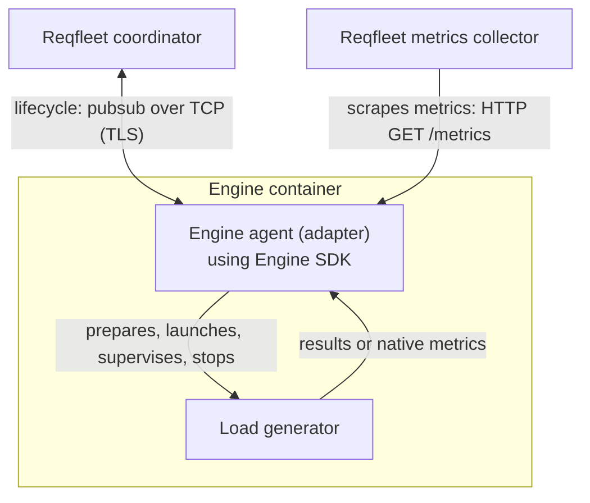

# Engine SDK

Engine SDK is the public Go runtime for running load-testing engines on
**Reqfleet**. An engine agent (adapter) uses the SDK to manage a load generator
and integrate it with Reqfleet's coordination and metrics collection.

The SDK exposes the same callback contract used by the existing JMeter, Locust,
and Replay engines. It was extracted from Reqfleet's Shibuya control plane and
has no dependency on the private control-plane module. The extracted SDK is
intended as a starting point for developers to add support for additional types
of engines on Reqfleet.

## Why this exists

Running an engine on Reqfleet requires more than starting its executable. The
engine must receive its assigned workload and input files, prepare dependencies,
report readiness and results, and stop without leaving processes or files that
interfere with the next run.

The SDK provides that common runtime so each adapter can concentrate on the
engine-specific work: translating an assigned run into native configuration,
building the command, and mapping engine output into Reqfleet's reporting
contract. Engines can retain their own execution model without each integration
reimplementing coordinator communication and process supervision.

## Basic architecture



The coordinator decides what each agent runs, including workload settings and
per-file input assignments. The adapter translates that assignment; it does not
redistribute workload. The runtime owns the primary process and serializes runs
so cleanup finishes before the next run reuses the workspace.

An agent requires a coordinator; this SDK is not a standalone engine runner.
Engine registration, deployment, storage backends, and control-plane reporting
remain outside this module. Implementing an adapter does not by itself register
a new engine with Reqfleet.

## Using the SDK

Add the SDK to an adapter's Go module:

```sh
go get github.com/reqfleet/engine-sdk@v0.1.1
```

Use the Go toolchain required by `go.mod` for the SDK revision you build; this
checkout declares its requirement in [go.mod](go.mod). Pin the SDK version and
review compatibility when upgrading: the Go API is pre-1.0.

For adapter development, start with [AGENTS.md](AGENTS.md). It covers the public
packages, callback lifecycle, configuration, workspace ownership, metrics
integration, and verification workflow, with links to the detailed contracts.

## Platform support

Deployed agents require Linux containers, including writable workspace paths and
cgroup CPU/memory files. Unix workload execution uses process groups so stopping
a run also terminates its descendants.

This checkout also supports Windows `amd64` and `arm64` builds for clients that
import SDK types and handlers. It does not support Windows agent execution:
`AgentServer.Run()` returns an error matching `errors.ErrUnsupported` before
starting workers, coordinator subscriptions, or HTTP listeners. The Windows
compatibility fix is unreleased; consumers pinned to `v0.1.1` need a release
containing this fix.

The PR workflow builds both Windows architectures and runs the unsupported
execution contract tests on a Windows runner. Linux retains the full SDK race
test suite and adapter conformance checks.

## Examples

[Preparing adapter](examples/preparing-adapter/README.md) translates assigned
settings into a run-local curl configuration through `BeforeStart`, then lets
the SDK launch and supervise curl. Its Docker conformance harness exercises real
requests, duplicate starts, startup failure, cancellation, and recovery.

The example is an independent module pinned to a released SDK version, so
root-level `go test ./...` does not run its harness. The
[`pr-test` workflow](.github/workflows/pr-test.yml) runs `make test` on pull
requests, covering both SDK race tests and the Docker conformance harness.
See the example README for prerequisites and standalone commands.

## Upload validation

The [`validation`](validation/doc.go) package defines a public Go contract for
upload-time artifact validation, separate from the agent runtime. This package
and the [`jsonvalidator`](examples/jsonvalidator) example are unreleased;
`v0.1.1` does not contain them. They require the next SDK release containing this
contract.

Implement `validation.Validator` with the signature
`func(context.Context, validation.Artifact) (validation.Result, error)`.
The hosting API compiles and trusts the callback and invokes it synchronously;
adding an adapter requires rebuilding that API. This is not an independently
installed plugin, process runner, sandbox, or new wire protocol. The Go contract
is versioned with the SDK release.

Validators must parse or compile only, never execute uploaded tests, and must
honor context cancellation where possible. Go cancellation is cooperative, not
forced termination or an independent memory quota. `Artifact.Content` remains
caller-owned and must not be mutated or retained after the callback returns.

| Status | Contract |
| --- | --- |
| `valid` | No diagnostics. |
| `invalid` | At least one diagnostic, each with nonempty `code` and `message`. |
| `unsupported` | Validation is unavailable; optional diagnostics explain why. Not success. |

Call `Result.Check()` to reject empty/unknown statuses, malformed diagnostics,
negative coordinates, and malformed analysis. Nonzero `line` and `column` values
are one-based; zero means unspecified. Diagnostics retain their order. A Go error
denotes an operational failure or cancellation, including analyzer failures,
never an invalid artifact. Return that error; do not downgrade it to an
`unsupported` or `dynamic` analysis result.

The same callback can return `Result.Analysis` alongside validation and reuse its
parsed content. These are independent outcomes: `valid` does not imply an exact
count is available. The public callback accepts no tier or label-limit input;
adapters return facts and the hosting control plane compares exact counts to its
tier policy. Invalid or unsupported **validation** results must not carry
analysis; unsupported **analysis** can accompany valid syntax.

`Analysis` is an optional `*validation.LabelAnalysis` with `Status`, `Unit`, and
integer `Count` fields:

| Analysis status | Meaning |
| --- | --- |
| `exact` | An exact nonnegative count. `Count: 0` means exactly zero. A nonblank `Unit` is required. |
| `dynamic` | Counted entities depend on execution; no exact static count is asserted. |
| `unsupported` | The analyzer cannot determine the count. |
| `not_applicable` | This analysis does not apply to the engine's artifact. |

For every non-exact status, `Count` must be zero and `Unit` is optional. This zero
does **not** assert zero entities. A nil `Analysis` means unavailable or not
supplied, never exact zero. JSON omits nil analysis and includes `count` even when
zero; consumers must inspect `status`, not treat the numeric field alone as proof.
`Unit` identifies engine-defined entities, such as `"tasks"`, `"test labels"`, or
`"request labels"`. In particular, Locust's static task/decorator count is not an
emitted request-label cardinality.

Validation and analysis do not grant upload admission or execution capability,
prove runtime cardinality safety, or transform content. Runtime still enforces
its distinct-label cap, including dynamically named labels. Non-exact metadata
does not itself authorize admission; the host requires an explicitly registered,
verified runtime-bounded integration. Registration, format/capability discovery,
upload safeguards, preparation, and tier policy belong to the host. Skipped
validation must not be represented as `valid`; hosts can separately call
`LabelAnalysis.Check()`, but an empty validation status is not a public callback
outcome.

The real [`jsonvalidator.Validate`](examples/jsonvalidator/validation.go) example
accepts:

```json
{"requests":[{"method":"GET","url":"https://example.com","label":"home"}]}
```

It rejects malformed/trailing JSON with `syntax` diagnostics and unknown fields,
invalid field types, empty request arrays/methods, and URLs without an HTTP(S)
scheme and host with `configuration` diagnostics. It never sends requests and
uses only standard-library and public SDK dependencies.

Static requests return an exact count of distinct request labels with
`Unit: "request labels"`. An omitted or empty `label` defaults to
`method + " " + URL`; repeated labels count once, including collisions between
explicit and default names. For example, the request above returns:

```json
{"status":"valid","analysis":{"status":"exact","unit":"request labels","count":1}}
```

Top-level `"dynamicLabels":true` declares runtime-generated request names:

```json
{"dynamicLabels":true,"requests":[{"method":"GET","url":"https://example.com"}]}
```

After the same syntax and configuration checks, it returns dynamic analysis
rather than a partial or guessed static count:

```json
{"status":"valid","analysis":{"status":"dynamic","unit":"request labels","count":0}}
```

Run `make test-validation` for the contract and JSON validator example tests with
race detection, without Docker. These tests also run through `make test-sdk` and
the full `make test` target.

## License

Licensed under [Apache-2.0](LICENSE). [NOTICE](NOTICE) records extraction provenance;
dependency licenses and notices are retained in [THIRD_PARTY_NOTICES](THIRD_PARTY_NOTICES).
