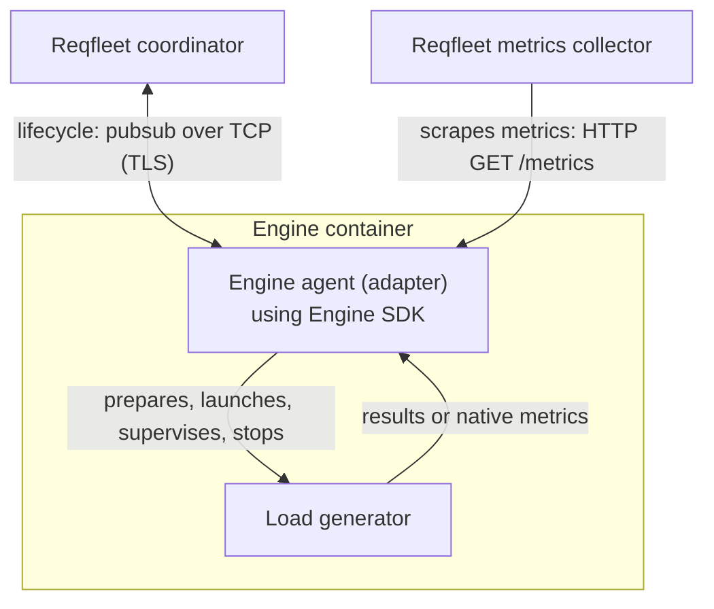

# Engine SDK

Engine SDK is the public Go runtime for running load-testing engines on
**Reqfleet**. An engine agent (adapter) uses the SDK to manage a load generator
and integrate it with Reqfleet's coordination and metrics collection.

The SDK exposes the same callback contract used by the existing JMeter, Locust,
and Replay engines. It was extracted from Reqfleet's Shibuya control plane and
has no dependency on the private control-plane module. The extracted SDK is
intended as a starting point for developers to add support for additional types
of engines on Reqfleet.

## Why this exists

Running an engine on Reqfleet requires more than starting its executable. The
engine must receive its assigned workload and input files, prepare dependencies,
report readiness and results, and stop without leaving processes or files that
interfere with the next run.

The SDK provides that common runtime so each adapter can concentrate on the
engine-specific work: translating an assigned run into native configuration,
building the command, and mapping engine output into Reqfleet's reporting
contract. Engines can retain their own execution model without each integration
reimplementing coordinator communication and process supervision.

## Basic architecture



The coordinator decides what each agent runs, including workload settings and
per-file input assignments. The adapter translates that assignment; it does not
redistribute workload. The runtime owns the primary process and serializes runs
so cleanup finishes before the next run reuses the workspace.

An agent requires a coordinator; this SDK is not a standalone engine runner.
Engine registration, deployment, storage backends, and control-plane reporting
remain outside this module. Implementing an adapter does not by itself register
a new engine with Reqfleet.

## Using the SDK

Add the SDK to an adapter's Go module:

```sh
go get github.com/reqfleet/engine-sdk@v0.1.1
```

Use the Go toolchain required by `go.mod` for the SDK revision you build; this
checkout declares its requirement in [go.mod](go.mod). Pin the SDK version and
review compatibility when upgrading: the Go API is pre-1.0.

For adapter development, start with [AGENTS.md](AGENTS.md). It covers the public
packages, callback lifecycle, configuration, workspace ownership, metrics
integration, and verification workflow, with links to the detailed contracts.

## Platform support

Deployed agents require Linux containers, including writable workspace paths and
cgroup CPU/memory files. Unix workload execution uses process groups so stopping
a run also terminates its descendants.

This checkout also supports Windows `amd64` and `arm64` builds for clients that
import SDK types and handlers. It does not support Windows agent execution:
`AgentServer.Run()` returns an error matching `errors.ErrUnsupported` before
starting workers, coordinator subscriptions, or HTTP listeners. The Windows
compatibility fix is unreleased; consumers pinned to `v0.1.1` need a release
containing this fix.

The PR workflow builds both Windows architectures and runs the unsupported
execution contract tests on a Windows runner. Linux retains the full SDK race
test suite and adapter conformance checks.

## Examples

[Preparing adapter](examples/preparing-adapter/README.md) translates assigned
settings into a run-local curl configuration through `BeforeStart`, then lets
the SDK launch and supervise curl. Its Docker conformance harness exercises real
requests, duplicate starts, startup failure, cancellation, and recovery.

The example is an independent module pinned to a released SDK version, so
root-level `go test ./...` does not run its harness. The
[`pr-test` workflow](.github/workflows/pr-test.yml) runs `make test` on pull
requests, covering both SDK race tests and the Docker conformance harness.
See the example README for prerequisites and standalone commands.

## Upload validation

The [`validation`](validation/doc.go) package defines a public Go contract for
optional, best-effort upload checks, separate from the agent runtime. Validation
and label counting provide early user feedback; neither is a runtime-safety
capability.

Implement `validation.Validator` with the signature:

```go
func(context.Context, validation.Artifact, validation.Options) (validation.Result, error)
```

The hosting API compiles and trusts the callback and invokes it synchronously;
adding an adapter requires rebuilding that API. This is not an independently
installed plugin, process runner, sandbox, or new wire protocol. The Go contract
is versioned with the SDK release.

Validators must parse or compile only, never execute uploaded tests, and must
honor context cancellation where possible. Go cancellation is cooperative, not
forced termination or an independent memory quota. `Artifact.Content` remains
caller-owned and must not be mutated or retained after the callback returns.

`validation.Options` has two independent flags:

| Field | JSON name | Effect when true |
| --- | --- | --- |
| `SkipPlanFileValidation` | `skip_plan_file_validation` | Skip artifact validation; counting may still run. |
| `SkipLabelCounting` | `skip_label_counting` | Skip counting; artifact validation may still run. |

Both flags default to false. Adapters must honor each flag independently.
An enabled check is still best-effort: an adapter may return `Skipped` when it
does not implement validation for the artifact, or omit a count it cannot
determine. Skipping validation must not be reported as `Valid`.

| Status | Contract |
| --- | --- |
| `valid` | Validation succeeded. No diagnostics; optional label count. |
| `invalid` | At least one diagnostic, each with nonempty `code` and `message`. No label count. |
| `skipped` | Validation was not performed. No diagnostics; optional label count. |

Call `Result.Check()` to reject empty/unknown statuses, malformed diagnostics,
negative coordinates, and malformed counts. Nonzero `line` and `column` values
are one-based; zero means unspecified. Diagnostics retain their order. A Go error
denotes an actual operational failure or cancellation, not an invalid artifact
or an unavailable best-effort count. Return operational errors rather than
pretending checks passed or converting them to `Skipped`.

`Result.LabelCount` is an optional `*validation.LabelCount` with integer `Count`
and string `Unit` fields. A supplied count must be nonnegative and its unit
nonblank. Nil means no count was supplied, not zero; JSON omits `label_count` in
that case. A supplied zero count is serialized as `"count":0`. A nil count never
blocks an upload on counting grounds. There are no count-completeness statuses.

`Unit` identifies engine-defined entities, such as `"tasks"`, `"test labels"`, or
`"request labels"`. Configured JMeter sampler labels and Locust's static task
counts are useful preflight information, not emitted request-label cardinality.
The callback takes no tier or label-limit input; the host may compare a supplied
count with its upload policy.

These checks do not grant execution capability, prove runtime cardinality safety,
or transform content. The control plane supplies the assigned numeric budget as
lowercase `label_limit`. Workloads inherit it through the process environment,
subject to `Command.Env` overrides; the SDK does not rewrite it from `LabelsUsageLimit`.
Native engines must enforce it themselves; native metrics stream through the SDK
without parsing or aggregation by default. `AgentServerOptions.FoldNativeMetrics`
explicitly opts into last-resort SDK folding, with per-scrape buffering and parsing
cost, text/identity negotiation, a 16 MiB snapshot bound, and validation for safe
aggregation. Result-file ingestion always enforces the SDK distinct-label budget.
Both enforcement paths permit N named labels plus one overflow label per agent/run.
See the [metrics contract](agent/metrics.md) for responsibilities and fallback
semantics. Registration, invocation, upload safeguards, mandatory content
preparation, and tier policy belong to the host.

The real [`jsonvalidator.Validate`](examples/jsonvalidator/validation.go) example
accepts:

```json
{"requests":[{"method":"GET","url":"https://example.com","label":"home"}]}
```

With validation enabled, it rejects malformed/trailing JSON with `syntax`
diagnostics and unknown fields, invalid field types, empty request arrays/methods,
and URLs without an HTTP(S) scheme and host with `configuration` diagnostics.
It never sends requests and uses only standard-library and public SDK
dependencies.

With counting enabled, static requests return a count of distinct request labels
with `Unit: "request labels"`. An omitted or empty `label` defaults to
`method + " " + URL`; repeated labels count once, including collisions between
explicit and default names. With both checks enabled, the request above returns:

```json
{"status":"valid","label_count":{"count":1,"unit":"request labels"}}
```

Setting `SkipPlanFileValidation` still allows counting parseable input without
requiring semantically valid methods or URLs. Unknown fields are ignored in this
mode; parsing failures or trailing input produce `{"status":"skipped"}` without
a count or diagnostics. A decoded empty requests array can report a zero count.
Setting `SkipLabelCounting` preserves validation and its diagnostics but omits
the count. Setting both flags returns `{"status":"skipped"}` without parsing.
Cancellation remains an error under every flag combination.

Top-level `"dynamicLabels":true` declares runtime-generated request names:

```json
{"dynamicLabels":true,"requests":[{"method":"GET","url":"https://example.com"}]}
```

With validation enabled, the same syntax and configuration checks run, but
counting supplies no count:

```json
{"status":"valid"}
```

Run `make test-validation` for the contract and JSON validator example tests with
race detection, without Docker. These tests also run through `make test-sdk` and
the full `make test` target.

## License

Licensed under [Apache-2.0](LICENSE). [NOTICE](NOTICE) records extraction provenance;
dependency licenses and notices are retained in [THIRD_PARTY_NOTICES](THIRD_PARTY_NOTICES).
