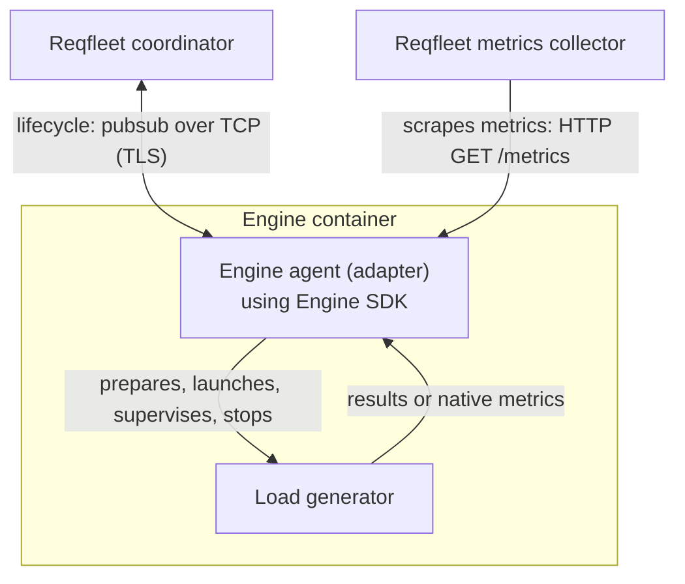

# Engine SDK

Engine SDK is the public Go runtime for running load-testing engines on
**Reqfleet**. An engine agent (adapter) uses the SDK to manage a load generator
and integrate it with Reqfleet's coordination and metrics collection.

The SDK exposes the same callback contract used by the existing JMeter, Locust,
and Replay engines. It was extracted from Reqfleet's Shibuya control plane and
has no dependency on the private control-plane module. The extracted SDK is
intended as a starting point for developers to add support for additional types
of engines on Reqfleet.

## Why this exists

Running an engine on Reqfleet requires more than starting its executable. The
engine must receive its assigned workload and input files, prepare dependencies,
report readiness and results, and stop without leaving processes or files that
interfere with the next run.

The SDK provides that common runtime so each adapter can concentrate on the
engine-specific work: translating an assigned run into native configuration,
building the command, and mapping engine output into Reqfleet's reporting
contract. Engines can retain their own execution model without each integration
reimplementing coordinator communication and process supervision.

## Basic architecture



The coordinator decides what each agent runs, including workload settings and
per-file input assignments. The adapter translates that assignment; it does not
redistribute workload. The runtime owns the primary process and serializes runs
so cleanup finishes before the next run reuses the workspace.

An agent requires a coordinator; this SDK is not a standalone engine runner.
Engine registration, deployment, storage backends, and control-plane reporting
remain outside this module. Implementing an adapter does not by itself register
a new engine with Reqfleet.

## Using the SDK

Add the SDK to an adapter's Go module:

```sh
go get github.com/reqfleet/engine-sdk@v0.1.1
```

Use the Go toolchain required by `go.mod` for the SDK revision you build; this
checkout declares its requirement in [go.mod](go.mod). Pin the SDK version and
review compatibility when upgrading: the Go API is pre-1.0.

For adapter development, start with [AGENTS.md](AGENTS.md). It covers the public
packages, callback lifecycle, configuration, workspace ownership, metrics
integration, and verification workflow, with links to the detailed contracts.

## Examples

[Preparing adapter](examples/preparing-adapter/README.md) translates assigned
settings into a run-local curl configuration through `BeforeStart`, then lets
the SDK launch and supervise curl. Its Docker conformance harness exercises real
requests, duplicate starts, startup failure, cancellation, and recovery.

The example is an independent module pinned to a released SDK version, so
root-level `go test ./...` does not run its harness. The
[`pr-test` workflow](.github/workflows/pr-test.yml) runs `make test` on pull
requests, covering both SDK race tests and the Docker conformance harness.
See the example README for prerequisites and standalone commands.

## License

Licensed under [Apache-2.0](LICENSE). [NOTICE](NOTICE) records extraction provenance;
dependency licenses and notices are retained in [THIRD_PARTY_NOTICES](THIRD_PARTY_NOTICES).
